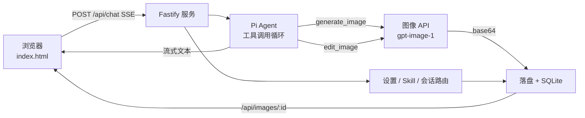

# AI Image Console · 图像工作台

> 一个跑在本地的 AI 图片生成控制台：用自然语言对话驱动 Agent 出图 / 改图，自带会话历史、图库、Skill 模板和可视化设置页。

- 🖼️ **对话式出图**：说“画一只赛博朋克猫”即可生成；上传图片后说“把背景换成海边”即可编辑。
- 🤖 **Agent 工具调用**：基于 [Pi Coding Agent](https://www.npmjs.com/package/@earendil-works/pi-coding-agent) 驱动 `generate_image` / `edit_image` 两个工具，支持多轮推理与 SSE 流式输出。
- 💬 **会话管理**：SQLite 持久化会话、消息与图片，切换会话可原样恢复。
- 🧩 **Skill 模板**：往 `server/skills/` 放一个 `SKILL.md`，即可用 `/skill-name` 复用提示词模板与参数预设。
- ⚙️ **双 API 独立配置**：对话模型与图像模型可使用不同的 Key / BaseURL / 模型名，兼容任意 OpenAI 格式端点。
- 🔐 **Key 不落前端**：设置页保存后写入本地 `server/data/runtime-config.json`（0600 权限），接口只返回“是否已配置”。

前端是零构建的原生 HTML/CSS/JS，后端是 TypeScript + Fastify，开箱即用。

---

## 快速开始

环境要求：**Node.js ≥ 24**（`node:sqlite` 已默认可用；Node 22.5–23.3 需加 `--experimental-sqlite`）。已安装 [Pi Agent SDK](https://www.npmjs.com/package/@earendil-works/pi-coding-agent) 所需的 Node 环境。

```bash
git clone https://github.com/ispengya/ai-image-console.git
cd ai-image-console

# 安装后端依赖（项目实际代码在 server/，根目录只做脚本代理）
npm install --prefix server

# 复制环境变量模板
cp server/.env.example server/.env
```

打开 `server/.env`，至少填入两组 Key：

```dotenv
# 对话 API：负责理解意图、调用工具
CHAT_API_KEY=sk-...
CHAT_BASE_URL=https://api.openai.com/v1
CHAT_MODEL=gpt-4o

# 图像 API：负责真正出图（gpt-image-1）
IMAGE_API_KEY=sk-...
IMAGE_BASE_URL=https://api.openai.com/v1
IMAGE_MODEL=gpt-image-1
```

启动：

```bash
npm run dev        # 开发模式（tsx watch）
# 生产模式
npm run build && npm start
```

启动后会自动打开 `http://127.0.0.1:3001`（`BROWSER=none` 可关闭自动打开）。

> 不想改 `.env`？直接打开控制台左侧 **设置** 页，在「对话 API」「图像 API」两组里填入 Key / 端点 / 模型即可，保存后立即生效并写入 `server/data/runtime-config.json`。

### 常用脚本

| 命令 | 作用 |
| --- | --- |
| `npm run dev` | 启动开发服务（`tsx watch`，修改后端自动重启） |
| `npm run build` | 编译 TypeScript 到 `server/dist` |
| `npm start` | 运行编译产物 |
| `npm run typecheck` | 只做类型检查 |

---

## 配置说明

所有配置都可以通过环境变量或设置页完成；设置页保存的值优先于 `.env`。

### 对话 API

| 变量 | 默认值 | 说明 |
| --- | --- | --- |
| `CHAT_API_KEY` | — | 对话模型 Key，留空时控制台仍能打开，但对话接口会返回 `MISSING_CHAT_API_KEY` |
| `CHAT_BASE_URL` | `https://api.openai.com/v1` | OpenAI 兼容端点 |
| `CHAT_MODEL` | `gpt-4o` | 对话模型名，可自由填写 |
| `CHAT_VISION` | `false` | 设为 `true` 后，上传的图片会作为视觉内容发给模型，模型可以“看到”画面 |
| `SYSTEM_PROMPT` | 内置提示词 | 自定义系统提示词，也可在设置页修改 |

### 图像 API

| 变量 | 默认值 | 说明 |
| --- | --- | --- |
| `IMAGE_API_KEY` | — | 图像模型 Key，缺失时出图工具返回 `MISSING_IMAGE_API_KEY` |
| `IMAGE_BASE_URL` | `https://api.openai.com/v1` | 图像端点 |
| `IMAGE_MODEL` | `gpt-image-1` | 图像模型；`gpt-image-*` 支持 `background` / `moderation` / `output_format` |

### 服务与其他

| 变量 | 默认值 | 说明 |
| --- | --- | --- |
| `PORT` | `3001` | 监听端口 |
| `CORS_ORIGIN` | `*` | 允许的来源，多个用逗号分隔 |
| `BROWSER` | `auto` | 启动后自动打开浏览器；`none` 关闭 |
| `PUBLIC_BASE_URL` | — | 对外访问地址，仅影响日志与自动打开 |
| `OUTPUT_DIR` | `./outputs` | 图片输出目录（相对 `server/`） |
| `SKILLS_DIR` | `./skills` | Skill 目录（相对 `server/`） |
| `OPENAI_API_KEY` / `OPENAI_BASE_URL` | — | 兼容旧配置：当上面两组留空时回退使用 |

---

## 使用方式

1. **直接出图**：在输入框描述画面，例如“画一张极简风格的山海日落插画，竖版”。
2. **修改图片**：点回形针上传原图，然后说“把色调改成冷色，保留构图”。有上传图时编辑默认基于上传图；否则基于当前会话最近生成的图。
3. **使用 Skill**：输入 `/` 会弹出可用 Skill 列表，例如 `/logo-design 一个咖啡店标志`。Skill 会展开提示词模板并应用参数预设，模型仍可覆盖参数。
4. **调参**：右侧面板可设置模型、尺寸、质量、数量、格式、背景、审核级别等；模型在调用工具时未显式指定参数会沿用这些默认值。
5. **管理历史**：左侧会话列表可切换 / 删除会话；图库视图展示所有生成结果，点击可看大图。

### Skill 格式

`server/skills/<name>/SKILL.md`：

```markdown
---
name: logo-design
label: Logo 设计
description: 简约矢量标志，默认透明背景
quality: high
background: transparent
size: 1024x1024
---

简约现代 LOGO 设计：{input}，矢量风格，扁平化，留白充足
```

- `name` 是 `/` 命令名；`description` 会注入系统提示词。
- 除 `name` / `label` / `description` / `enabled` 外的 frontmatter 字段会作为工具参数预设，在参数合并时生效（优先级：界面默认值 < Skill 预设 < 模型显式参数）。
- 正文中 `{input}` 会被替换为用户输入；若正文不含 `{input}`，则正文作为完整指令，用户请求附在末尾。
- 设置 `enabled: false` 可临时停用。

---

## 架构



请求链路：

1. 前端把消息、历史、附件和生成参数 POST 到 `/api/chat`。
2. 服务端先落库用户消息与上传原图，然后以 SSE 建立流。
3. `agent/pi-agent.ts` 组装系统提示词（注入 Skill 列表、参数默认值、最近历史），启动 Pi Agent 会话。
4. 模型决定调用 `generate_image` 或 `edit_image`；工具执行时调用 OpenAI 兼容接口，把 base64 结果写入 `outputs/<conversationId>/` 并记录到 SQLite。
5. 图片、工具状态、文本增量都以 SSE 事件推回前端；助手回复与本轮图片 ID 在结束时落库。

### 目录结构

```
.
├── index.html              # 单文件前端（原生 JS/CSS，无需构建）
├── package.json            # 根脚本代理：npm --prefix server ...
└── server/
    ├── src/
    │   ├── index.ts        # Fastify 启动、静态托管、路由注册
    │   ├── config.ts       # 环境变量 + 运行时配置（热更新）
    │   ├── types.ts        # 共享类型与 SSE 事件协议
    │   ├── agent/
    │   │   ├── pi-agent.ts # Pi Agent 工具定义与执行（当前实现）
    │   │   ├── loop.ts     # 早期手写 function calling 循环（已弃用，留作参考）
    │   │   └── schemas.ts  # 工具参数 Zod / JSON Schema
    │   ├── routes/         # chat / config / conversations / images / skills
    │   ├── services/
    │   │   ├── openai.ts   # 图像生成、编辑、连接测试
    │   │   └── storage.ts  # SQLite + 文件落盘
    │   └── skills/loader.ts# SKILL.md 解析与加载
    ├── skills/             # 本地 Skill（默认 git 忽略）
    ├── data/               # 运行时配置（含 Key，git 忽略）
    └── outputs/            # 生成图片与 SQLite 历史（git 忽略）
```

### API 一览

| 方法 | 路径 | 说明 |
| --- | --- | --- |
| `POST` | `/api/chat` | SSE 对话，事件类型：`status` / `tool_call` / `tool_result` / `image` / `text` / `error` / `done` |
| `GET` | `/api/config` | 读取非敏感配置与 Key 配置状态 |
| `PUT` | `/api/config` | 更新运行时配置（热更新并落盘） |
| `POST` | `/api/test-connection/chat` | 测试对话 API 连通性 |
| `POST` | `/api/test-connection/image` | 测试图像 API 连通性 |
| `GET` | `/api/conversations` | 会话列表 |
| `GET` | `/api/conversations/:id/messages` | 会话消息历史 |
| `GET` | `/api/conversations/:id/images` | 会话图片（`includeSources=1` 含上传原图） |
| `DELETE` | `/api/conversations/:id` | 删除会话及磁盘目录 |
| `GET` | `/api/images` | 最近生成图片 |
| `GET` | `/api/images/:id` | 图片文件 |
| `GET` | `/api/skills` | 已加载 Skill 列表 |

---

## 安全与数据

- **不要提交密钥**：`server/.env`、`server/data/`、`server/outputs/`、`server/skills/` 均已在 `.gitignore` 中排除。运行时配置以 `0600` 权限写入 `server/data/runtime-config.json`。
- **接口不回显 Key**：`GET /api/config` 只返回 `chatApiKeyConfigured` / `imageApiKeyConfigured` 布尔值。
- **本服务没有内置鉴权**，默认监听 `0.0.0.0` 且 `CORS_ORIGIN=*`，设计为本地个人使用。如需暴露到公网，请在前面加反向代理、鉴权与限流，并收紧 CORS。
- 生成图片和会话历史保存在本地 `server/outputs/`，删除会话会同时删除对应目录。

## 已知限制

- 仅支持返回 base64 的图像接口（收到 URL 会返回 `UNEXPECTED_FORMAT`）。
- 依赖 Node.js 内置 `node:sqlite`（实验性 API），升级 Node 主版本时请留意行为变化。
- 单用户、无鉴权、无多租户隔离，不适合直接作为多人在线服务。
- `agent/loop.ts` 为早期实现，当前不会被执行。

## 致谢

- [Fastify](https://fastify.dev/)
- [Pi Coding Agent](https://www.npmjs.com/package/@earendil-works/pi-coding-agent)
- [OpenAI Node SDK](https://www.npmjs.com/package/openai)
